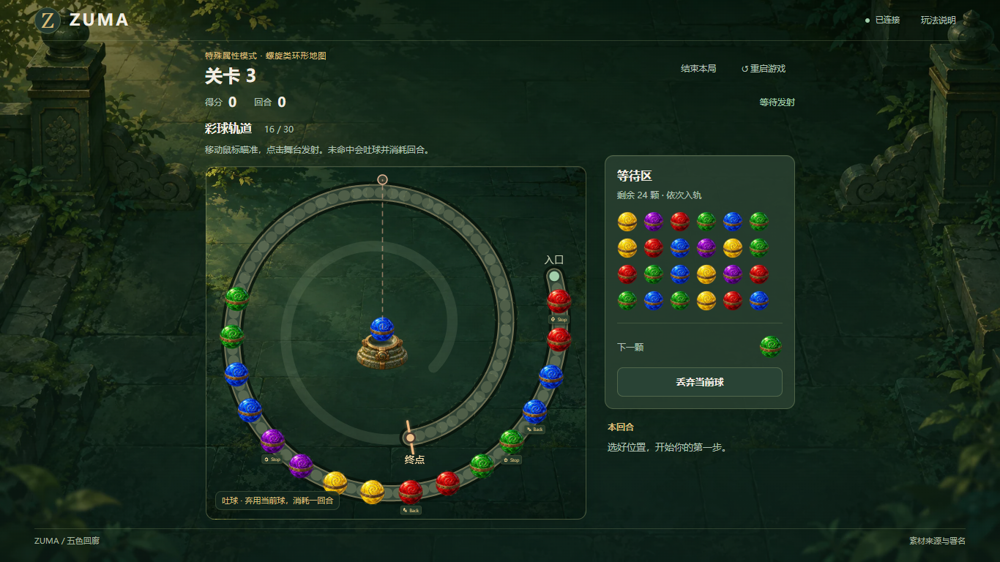
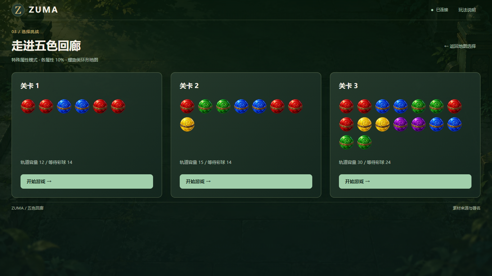
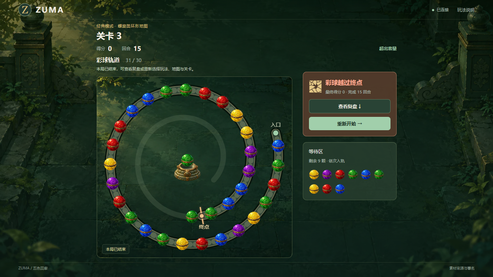
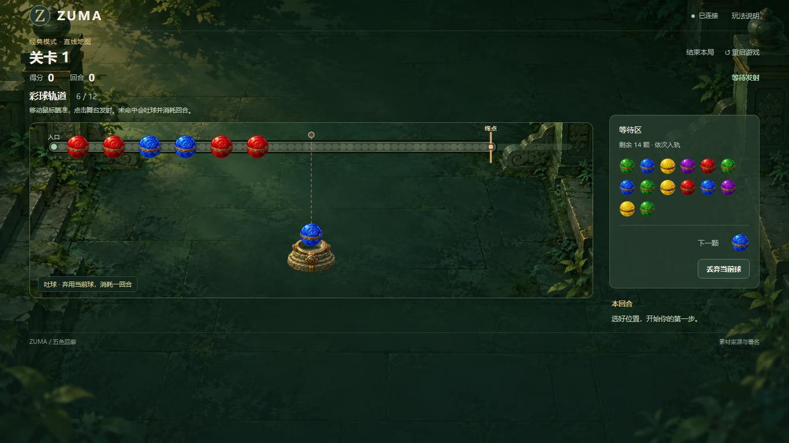
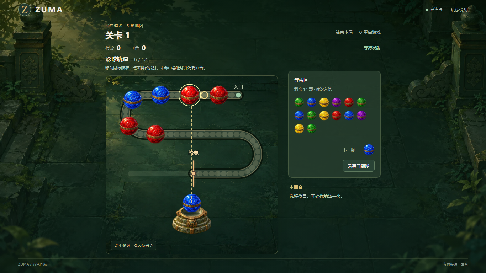
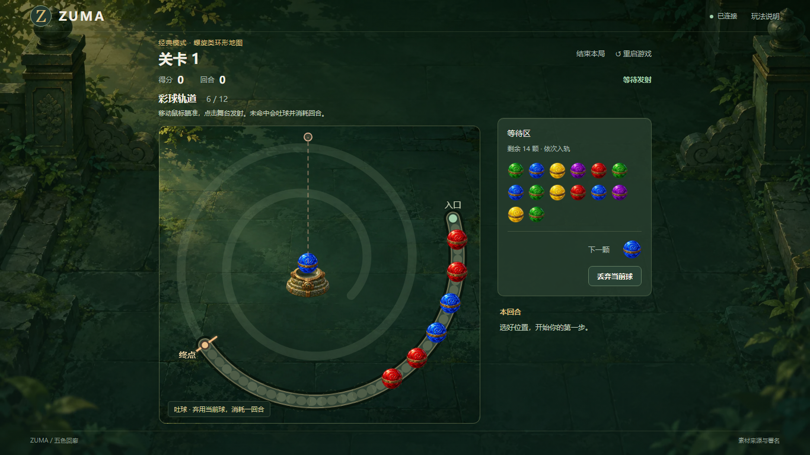
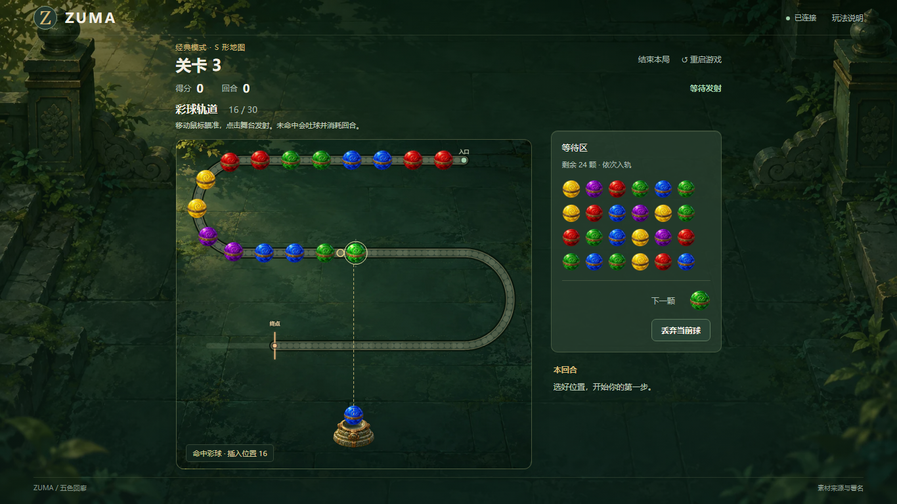
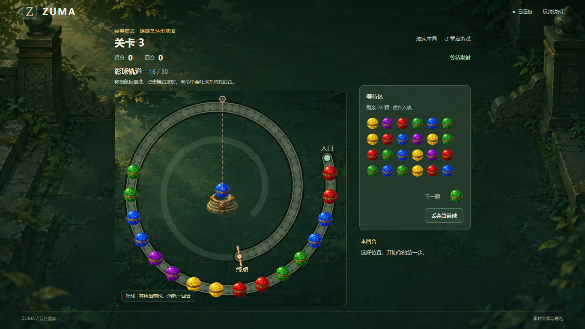

# 后期地图与瞄准建设记录

日期：2026-10-14。环境：本机 Windows、MinGW/C++17 与桌面 Chromium。按照《Zuma 后期建设方案》开始实现，继续使用已有两关和同一 C++ 消除规则核心。

后续新增第三关用于更长轨道与关卡扩展验证：初始 16 球、等待 24 球、16 颗循环弹药、容量 30。CLI 与 GUI 从关卡目录自动发现 `levelN.txt`；第三关可使用所有地图和玩法。

## 统一视觉规范执行

根据 [Zuma 统一界面视觉规范](../页面设计/Zuma%20统一界面视觉规范.md) 重整 `web/style.css`。移除已弃用的编号轨道、底部操作栏、旧全宽结束横幅和多轮布局覆盖；变量、基础、按钮、选择页、游戏、地图绘制、复盘、对话框及桌面空间适配分别集中维护。

沿用森林绿、古金、米白、暖珊瑚及已有宝石素材。文字和间距通过统一变量管理；按钮采用主/次/轻三级，具有稳定的悬停和键盘焦点；辅助卡片共用 12px 圆角、细描边和轻阴影。三个关卡的说明和开始按钮沿同一底线对齐。

验证结果：54 组桌面/地图/玩法/关卡流程、120 个前后端瞄准方向、15 组核心特殊效果事件轨迹全部通过。另检查玩法与地图选择、三关预览、说明窗口、按钮悬停不移动、2px 键盘焦点，以及 13px 操作文字、8px 控件圆角、12px 卡片圆角的实际显示。地图球径、瞄准、终点和回合结算保持原有行为。

## 已构建内容

1. 选择流程为玩法、地图、关卡，经典和特殊球模式均可使用直线、S 形、螺旋类环形三张开放地图。特殊属性的概率与触发规则保持原样。
2. 新增游戏舞台卡片，包含路径、轨道球、发射台、瞄准线、插入预览和临时效果；直线发射台底部居中，S 形发射台在下方，螺旋地图发射台在中心内侧。
3. C++ 服务端输出地图坐标和采样路径，并权威判断首个球体/相邻球间隙及插入位置。页面的预览使用同一组几何数据，发射只提交方向。旧编号接口保留供核心一致性测试，GUI 操作使用瞄准。
4. 射线最先遇到的球体或相邻球心连线段拦截发射。前排间隙能插入球，不会漏到后排；正方向分界平局固定插到目标球之后。
5. 无命中时，球的前缘飞到舞台卡片边缘后消失；服务实际调用 `Game::discard()`，完整复用弹药、FEED、Stop、回合和胜败判定，事件与复盘标为吐球。
6. 沿轨道插入和等待球入轨时，后续球根据稳定 ID 沿路径推移；临时飞球和消除特效全部放在裁切层内。
7. 终局复盘保存真实回合结束状态与事件，并加入地图缩略图、发射射线和吐球标识；重新开始清空旧局。

## 几何与布局

直线与 S 形地图的世界坐标球径为 68，球心沿路径的间距为 102，安全边距为 68。螺旋地图按后续反馈缩小到球径 44、间距 66、安全边距 44，路径绕中心 2.15 圈；每圈之间的球边缘间距至少留出一个球径。页面缩放整张场景，发射球及底座同步适配地图球径。地图容量继续使用关卡 MAX_LENGTH（12/15），更长路径上的多余部分留空，入口与终点不构成循环邻接。

舞台卡片与内部地图画布具有相同长宽比，并按桌面可用宽高缩放。这样吐球到达的画布边界就是可见卡片边界，不会停在卡片内部留白处。当前布局改为较大舞台加右侧信息区：等待球、下一颗球、丢弃、回合事件和结束结果集中在侧栏；取消宽大的外围暗色面板，提高场景亮度。复盘长流程图由用户展开后允许自然滚动。

### 终点误导修正

原来的“终点”标在完整曲线末端，而失败依据 MAX_LENGTH，长地图可能在球尚未到达标记时结束。本次将可见终点放在第 MAX_LENGTH 个合法球位之后、首个超限球位之前，其路径距离为 `diameter + (MAX_LENGTH - 0.5) × pitch`。例如容量 30 时，终点位于第 30 和第 31 个球位之间；第 31 颗球越线后完成回合即判负。未使用的剩余路径淡化，删除重复的“容量边界”提示。

主舞台与复盘共用绘制函数，终点位置保持一致。浏览器验收增加终点坐标、合法/超限球位之间的距离关系、唯一终点标记，以及三张地图第三关的失败截图；正常与结束画面都保持完整显示。

## 验证入口与覆盖

`ctest --test-dir build --output-on-failure` 包含五组检查：既有规则、API 一致性、地图与瞄准、核心动画轨迹导出、真实 HTTP 契约。新增地图检查覆盖分界侧、平局、相邻球间隙、前后轨段遮挡、空轨道、吐球边界、超限球位、非法方向状态不变、重复请求，以及吐球和弃球逐字段状态相等。

浏览器验收使用 `tests/map_browser_checks.mjs`。该脚本使用项目已有的本地 Playwright 测试依赖，不属于正常运行依赖。先启动测试服务 `build/zuma_gui.exe --port 8085 --test-mode`，再运行 `node tests/map_browser_checks.mjs http://127.0.0.1:8085`。结果与截图输出在 `build/map-checks/`。

- 1280×720、1366×768、1920×1080 三种桌面尺寸。
- 三张地图 × 两种玩法 × 两关，覆盖初始状态、持续入轨、满容量、失败、终局复盘和重开清理。
- 第三关加入同一浏览器流程，覆盖三张地图、两种玩法、三个桌面尺寸；CLI 验证显示初始 16/30 和等待区 24 球。真实 HTTP 检查还验证不连续编号和运行中新增关卡文件自动出现。
- 120 个实际请求的瞄准方向，逐项比较页面预览与服务端的命中类型及插入位置。
- 实际瞄准发射与连锁得分、吐球、跳过动画、主动结束、实际回合记录和舞台裁切。
- C++ 导出的连锁、Boom、Stop、Back、Stop 停滞事件轨迹用于三张地图，逐球比较最终 ID、颜色、属性，并检查临时效果清理。

结果：五组 CTest 全部通过；新增第三关后，54 种桌面尺寸/地图/玩法/关卡组合通过布局及终局流程检查；120 个瞄准方向的预览与服务端结果一致；15 组特殊球/连锁事件轨迹通过，浏览器没有页面错误或残留临时效果。第三关选择预览的换行与关卡目录同步也已核对。

两圈螺旋修订额外增加了实际绕中心角度不少于两整圈、缩小球径、相邻圈实际安全间距的检查。地图选项缩略图、球位、命中半径、飞球和复盘统一使用新尺寸；动画临时球显式设置最小宽度，避免小球被旧样式撑大。最终螺旋专项浏览器检查可通过命令末尾增加 `--spiral-only` 运行。

本次修正了宽舞台留白与吐球边界不一致、隐藏界面首次布局测量无效，以及入轨球和曲线位移动画重复处理的问题。测试服务使用独立端口；最终程序仍覆盖在 `build/zuma_gui.exe`，没有建立新版目录。

## 地图初始画面

以下为 1366×768 桌面浏览器的实际截图。

### 直线

### S 形

### 螺旋类环形

## 课程报告可补充的设计要点

第三关的长轨道画面：

新增地图展示了“逻辑球序与几何路径分离”：TRACK 仍使用原有顺序容器，消除只依据球序；地图提供空间位置和局部方向，负责瞄准及动画。射线与圆及相邻线段的求交选择最近目标，再用目标位置的切线判断插入侧。服务端提交权威结果，网页仅绘制预览和回合动画，避免两端分别实现消除规则。

复盘使用每回合结束时的真实快照与事件，而不是重新模拟整局。稳定球 ID 可以把动画过程和最终状态对应起来；吐球复用弃球结算则避免新增操作重复维护规则。报告可结合上面的实际地图截图说明这些设计。
